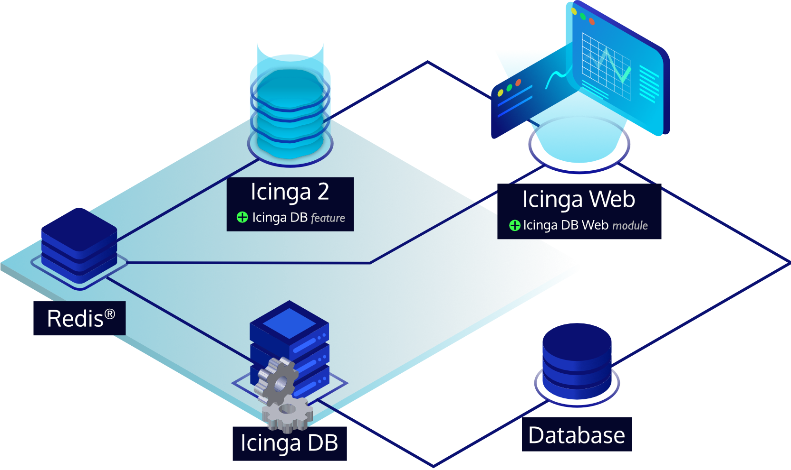

# Icinga Compose

A complete Icinga monitoring stack on your machine, with a single command:

- **Icinga 2**: the monitoring core
- **Icinga DB** with Redis®[\*](TRADEMARKS.md#redis): moves monitoring state into a database
- **Icinga Web**: the web UI, with Director, Graphite graphs, x509
  certificate monitoring, Business Process and Cube
- **MariaDB** or **PostgreSQL**: your choice
- **Graphite**: stores performance data

Everything comes from published container images, and Director sets up
an example that monitors the stack's own containers, so there's something
to look at right away.

## Big Picture

Icinga 2 checks hosts and services and writes their state to Redis.
The Icinga DB daemon synchronizes it from there into the SQL database.
Icinga Web and its modules read from the database, and from Graphite for graphs.
Director generates Icinga 2 configuration from its own database and deploys it through Icinga 2's API.
